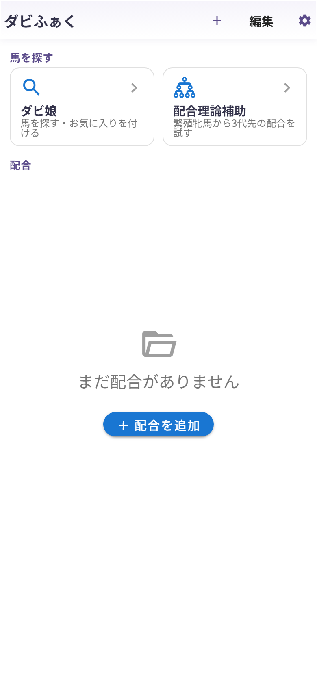
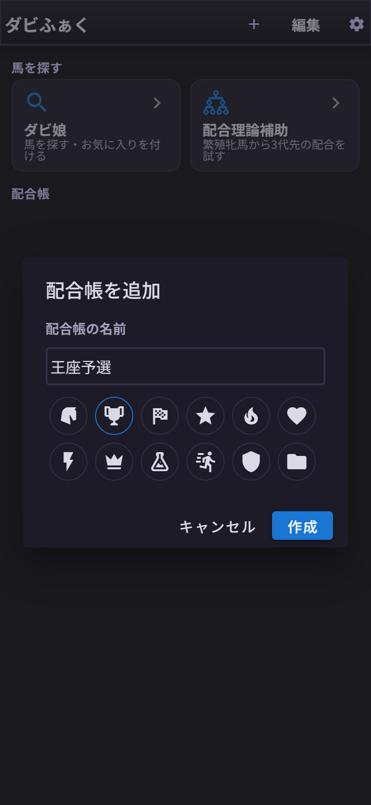

# 第2章 ホーム画面と配合 ── まずは作戦ボードを1枚

統合版を初めて開くと、こんなホーム画面が出迎えてくれます。

まだ何もない、キックオフ前の静けさ。
画面は上下2つに分かれていて、上が **「馬を探す」**、下が **「配合」** です。

## 上段「馬を探す」の2枚のカード

- **ダビ娘**(馬を探す・お気に入りを付ける) …… 条件を指定して馬を探す画面です(第4章)
- **配合理論補助**(繁殖牝馬から3代先の配合を試す) …… 代ごとに種牡馬を重ねていく画面です(第7章)

どちらも血統表とは別の独立した画面で、ここからいつでも行き来できます。

## 下段「配合」を作る

ホームに並ぶ「配合」は、1つが血統表1枚ぶん。作戦ボード1枚、と考えてください。
中央の **「＋ 配合を追加」** を押してみましょう。配合が1つでもあると、並びの最後に点線の **「配合を追加」** カードが出ます。右上の「＋」も同じ働きです。ちなみに右上の歯車マークは設定画面への入口です(第13章で)。

**配合の名前**(12文字まで)を入力して、12種類のアイコンから好きなものを選びます。入力欄には「例：ディープ産駒用、凱旋門賞狙い」と出ているので、何を狙った配合なのかで名前を付けると、あとで迷いません。
私は「王座予選」という名前にして、トロフィーのアイコンを選びました。優勝する気しかないので。

**「作成」** を押すと、まっさらな血統表がそのまま開きます。

## 以前から使っていた方へ

以前の検討内容がある方は、統合版を初めて開いたときに **「既存データ」という配合が自動で作られ、検討内容はその中にそのまま引き継がれます**。データが消えることはないので、安心してくださいね。むしろ「あ、私の配合、個室をもらえたんだ」くらいの気持ちでいてください(笑)。

## 次に開いたときは

2回目以降にアプリを開くと、ホームではなく **前回開いていた画面** に直行します。配合を開いていたならその配合へ。ダビ娘や配合理論補助を開いたまま閉じたなら、その画面へ。「アプリを開く=即、作業再開」。ロッカールームに寄らずピッチに直行するタイプです。ホームに戻りたいときは、血統表の左上の **「←」** からどうぞ(第5章で)。
