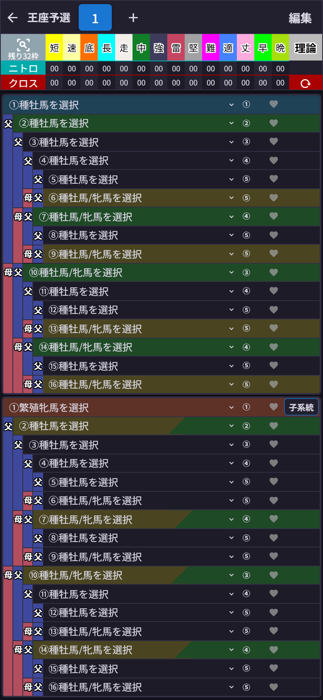
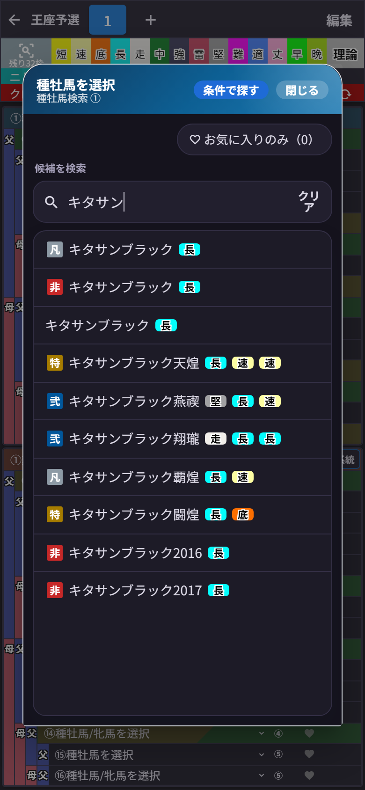
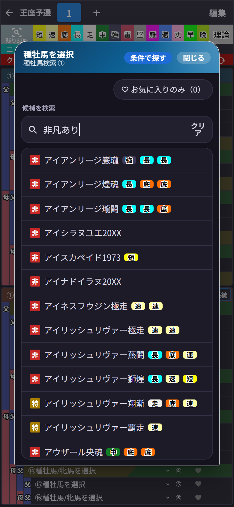
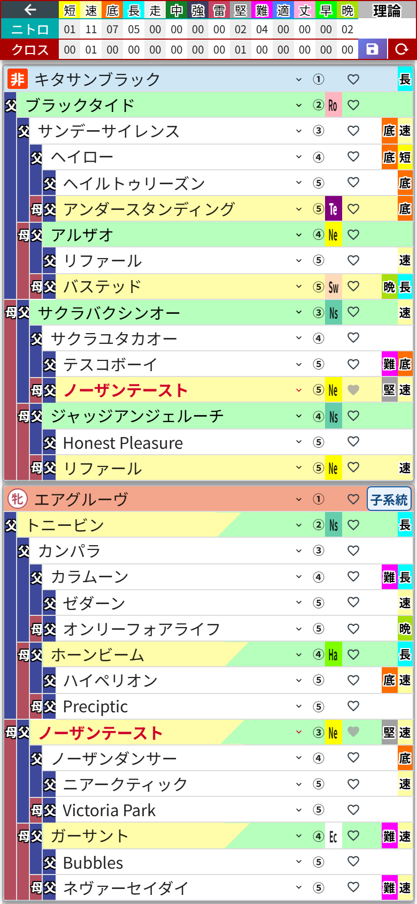
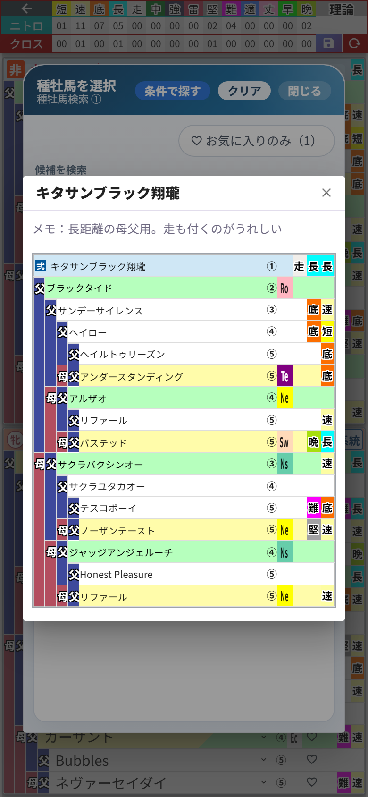
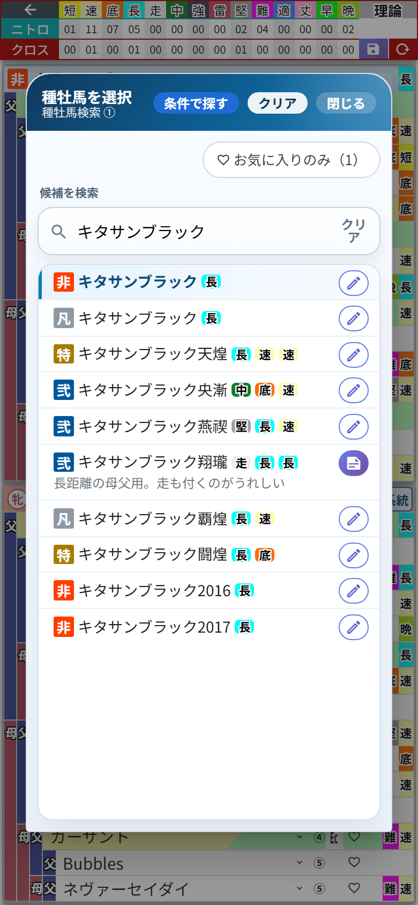
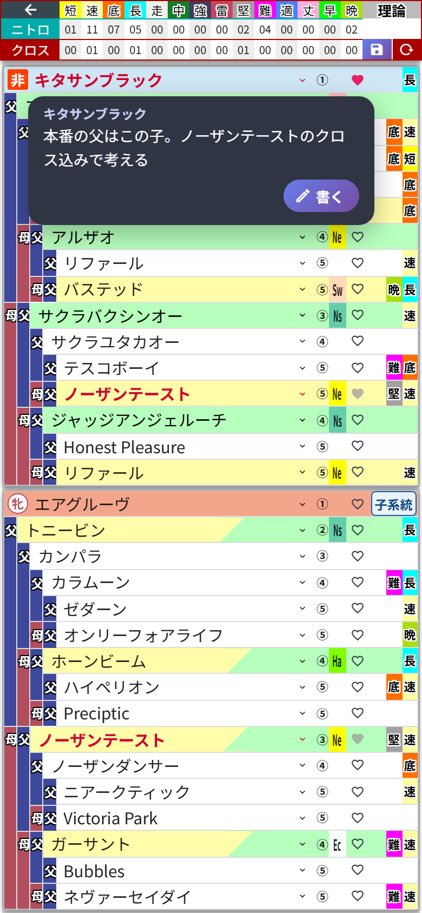

# 第3章 血統表に馬を置いてみよう ── 検索・バッジ・馬のメモ

ホームで配合を開くと、見慣れた(初めての方は今日から見慣れる)血統表の画面です。

画面の上から順に、

- **集計ヘッダー**(左上の「←」と、ニトロとクロスの数字が並ぶ段。読み方は第5章で)
- **血統表**(上のカードが父側=種牡馬、下のカードが母側=繁殖牝馬)

という並びになっています。上に余計な帯がないぶん、血統表の1行1行が大きく取ってあります。

## 馬を選んでみる

いちばん上の **「①種牡馬を選択」** をタップすると、検索ダイアログが開きます。

名前を入力すると候補がすぐに絞り込まれます。ひらがな・カタカナはどちらでも大丈夫。馬名の左右には小さなバッジが付いていて、これがなかなかの情報源です。

- **凡・非・弐・特** …… ★5種牡馬の非凡タイプ(非凡なし・非凡あり・弐重非凡・特化非凡)。「非」だけは朱色にしてあります
- **祭** …… 因名祭の馬
- **E** …… 設定画面で登録したエディット種牡馬(第13章)
- **牝** …… 繁殖牝馬。白抜きの丸に臙脂の文字です
- **自** …… 配合保存で作った自分の馬(第10章)。すぐ隣に白抜きの丸で **牡**(紺)か **牝**(臙脂)が付くので、種牡馬として作ったのか繁殖牝馬として作ったのかもひと目でわかります
- 右側の色付きバッジ …… その馬が持つ因子

そしてこのバッジ、**言葉で検索できます**。たとえば「非凡あり」と打つと──

非凡持ちだけがずらり(弐重非凡・特化非凡も一緒に出ます)。「特化非凡」「弐重非凡」「因名祭」「自家製」のように、もっと絞った言葉も使えます。スカウト網の検索条件が細かい。頼もしいです。

ダイアログの上には、覚えておくと便利なボタンが3つ並んでいます。

- **条件で探す** …… 能力や脚質など、名前以外の条件で探したいときの入口です(スマホ表示のみ。第4章で!)
- **クリア** …… そのマスだけ未選択に戻します(馬を置いているときだけ出ます)
- **閉じる** …… 何も変えずに閉じます

その下の **「お気に入りのみ(0)」** は、❤ を付けた馬だけに候補を絞るスイッチ。これも第4章で一緒に説明しますね。

今回は説明用に、キタサンブラックを種牡馬に、エアグルーヴを繁殖牝馬に選んでみました。

どうでしょう、この情報量!

- 5代分の血統が**自動で展開**されて、
- 集計ヘッダーにはニトロの数がずらっと並んで、
- クロスが発生している馬(この配合だとノーザンテースト)は **赤い文字** で教えてくれます。

自分で家系図を書いて数えていた時代を思うと、涙が出ます。

## ここがすごいよ、個別入れ替え

血統表は「先頭の2頭を選んだら終わり」ではありません。**32マスすべて、どのマスも個別にタップして別の馬に差し替えられます**。

「⑥だけ別の種牡馬にしたら、クロスがもう1本増えるのでは?」
「この④を因子持ちに替えたら、ニトロが伸びるのでは?」

……という細かい采配が自由自在。選手交代のカードを何枚でも切れる監督、最高です。

深いマスに馬を置いたとき、その手前が「★1薄め○○」のような馬で自動的に埋まることがありますが、これは正常な動きです(第9章で説明しますね)。

「種牡馬/牝馬を選択」と書かれた深いマスには、繁殖牝馬も置けます。牝馬を選ぶと、そのマスには **「牝馬名(その父の名前)」** の形で表示されて、頭に「牝」のバッジが付きます。主役はあくまで牝馬のほう、という並びです。

## 候補の馬の血統表をのぞく

選ぶ画面で「この馬、母父は何だったっけ?」と思ったら、いちいち置いて確かめる必要はありません。

- **スマホ** …… 候補の行を **長押し**(0.5秒ほど押したまま)
- **PC** …… 候補の行の右端にある **家系図のマーク**(「血統表を見る」)

これで、その馬の5代血統表が別の画面で開きます。選んだことにはならないので、閉じればそのまま候補選びの続きです。メモ(次の項)を書いてある馬は、血統表の上にメモも出ます。置いてから外す、の往復がなくなるだけで、検討のテンポがまるで違います。

## 馬にメモを付ける

種牡馬にも繁殖牝馬にも、**馬ごとのメモ**(100文字まで、改行もできます)を残せます。「この子は短で使う」「母父に入れると見事が出やすい」といった、自分だけの選手名鑑です。

- **書く** …… 選ぶ画面で、候補の行の右端の **鉛筆のマーク** を押します。メモがある馬は、鉛筆がメモ帳の形のマークに変わります
- **候補で見る** …… メモの1行目が、馬名の下に小さく出ます
- **血統表で見る** …… メモがある馬のマスでは、スマホは **長押し** で吹き出しにメモの全文が出ます。吹き出しの **「書く」** からそのまま書き直せます。PCはマウスを重ねるだけで出ます

同じ馬なら、血統表のどのマスに出てきても同じメモが出ます。☆の馬(第10章)のメモは、保存した配合に付けるメモと同じものです。どちらで書いても、両方に反映されます。

ひとつだけ注意です。公式の種牡馬・繁殖牝馬のメモは **この端末の中にだけ** 残ります。スマホとPCで別々に使っている方は、それぞれで書いてくださいね。★の仮の馬とワタシノヒンバ(どちらも第9章)は実在の馬ではないので、メモの対象外です。
