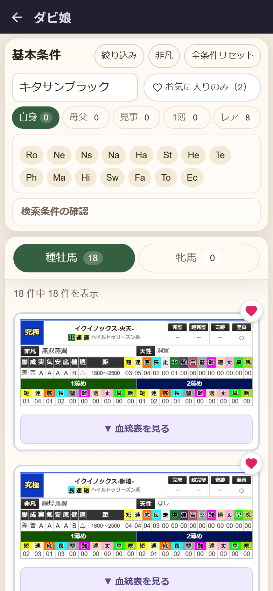
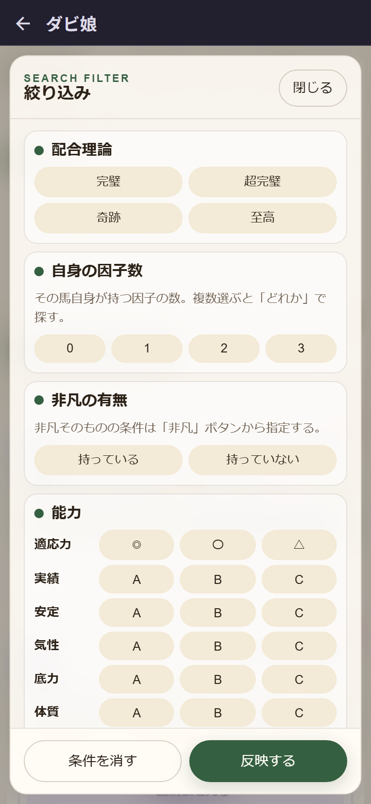
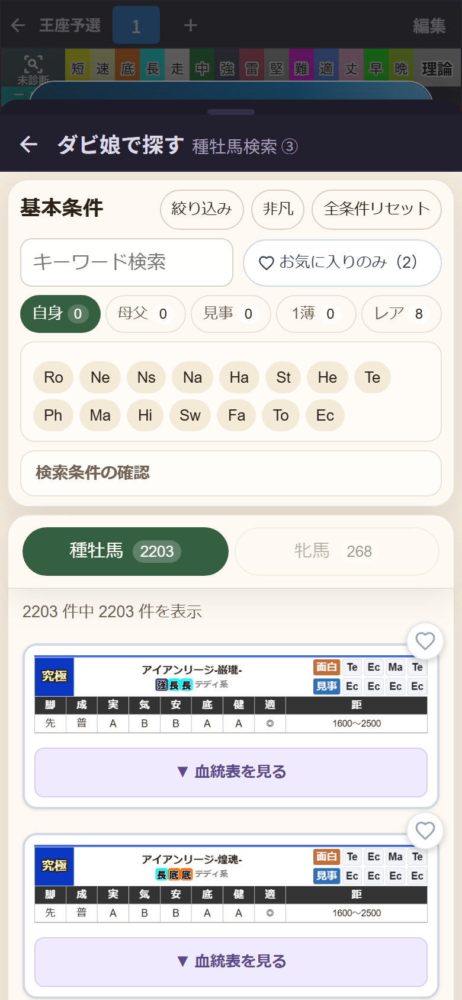

# 第4章 ダビ娘で探す ── 条件検索とお気に入り

名前で探すだけなら第3章の検索ダイアログで十分なのですが、配合を詰めていくと、こういう探し方をしたくなりませんか。

「底力Aで、晩成で、ノーザンダンサー系の種牡馬っていない?」
「非凡持ちで、差しで、長距離が守備範囲の子を並べて見たい」

そのための専用の検索アプリが **ダビ娘** です。これまで別のアプリだったものが、今回まるごとダビふぁくの中に入りました。スカウト部門がクラブハウスに引っ越してきた、と思ってください。

## 2つの入口

- **ホーム画面の「ダビ娘」カード** …… じっくり馬を眺めたいとき。血統表とは切り離された1枚の画面です
- **血統表のマス → 検索ダイアログの「条件で探す」** …… いま開いているマスに入れる馬を探すとき(スマホ表示のみ)

まずはホームから開いてみます。

いちばん上が **「基本条件」** のブロックです。

- **キーワード検索** …… 馬名だけでなく、**血統表の中身まで探してくれます**。この画面では「キタサンブラック」と入れているので、キタサンブラックを先祖に持つ馬がずらりと出ています
- **お気に入りのみ** …… ❤ を付けた馬だけに絞ります(後述)
- **自身 / 母父 / 見事 / 1薄 / レア** …… どの立場で系統を見るかの切り替えと、レア度の指定
- **Ro / Ne / Ns / Na / Ha / St / He / Te / Ph / Ma / Hi / Sw / Fa / To / Ec** …… 親系統の略号。タップした系統だけに絞れます
- **検索条件の確認** …… いま何を指定しているかを開いて確認できます

結果は **種牡馬 / 牝馬** のタブで分かれていて、件数も出ます。カードの **「▼ 血統表を見る」** を押せば、その場で5代分の血統表が開きます。

ホームから開いた単体画面は、条件を何も指定していないうちは結果を出しません(「検索条件を選択してください」と出ます)。2,000頭以上を無条件で並べても仕方ないので、まずは条件から。

## 「絞り込み」でもっと細かく

上部の **「絞り込み」** を押すと、条件の引き出しが一気に開きます。

- **配合理論** …… 完璧 / 超完璧 / 奇跡 / 至高
- **自身の因子数** …… 0 / 1 / 2 / 3(複数選ぶと「どれか」で探します)
- **非凡の有無** …… 持っている / 持っていない
- **能力** …… 適応力(◎〇△)、実績・安定・気性・底力・体質(ABC)
- **脚質** …… 逃げ / 先行 / 差し / 追込 / 自在
- **成長型** …… 早熟 / 普通 / 晩成
- **天性** …… 情熱 / 洞察 / 飛燕 / 颶風
- **血統** …… 自身の子系統、母父の子系統、そして **祖先指定**(祖先名と、自身・１父・父父・母父・１薄・見事・以外 といった位置をセットで指定)

決めたら **「反映する」**、やり直したければ **「条件を消す」**。
隣の **「非凡」** ボタンは、騎乗指示・レース・馬場状態・天候から非凡そのものを探すための専用パネルです。

ここまで条件を刻める検索、そうそうありません。私は「晩成・底力A・追込」で延々と眺めていて、気づいたら日付が変わっていました。

## 血統表のマスから呼ぶとき

スマホ表示で、血統表のマスの検索ダイアログの **「条件で探す」** を押すと、同じダビ娘が下からせり上がってきます。

見出しが **「ダビ娘で探す」** に変わり、右に「種牡馬検索 ③」のように、いまどのマスを埋めようとしているかが出ます。**そのマスに入れられる性別だけ**が最初から絞られているのも親切なところ。

選び方は2段階です。

1. 馬のカードをタップする(カードに「選択を解除する」が出ます)
2. 画面の下に出たバーの **「この馬を入れる」** を押す

これでシートが閉じて、血統表のマスに入ります。間違えたら **「やめる」** で戻れます。一拍置く手順のおかげで、誤タップで配合が崩れることがありません。

なお、ダビ娘にはいてもダビふぁく側にデータが無い馬がわずかにいます。その馬を選ぶと「『○○』はダビふぁく未対応の馬です」と教えてくれます。マスと性別が合っていないときも「このセルには種牡馬しか入りません」のように止めてくれるので、安心してタップしてください。

## ❤ お気に入り ── 候補を自分のリストに絞る

カードの右上の **❤** をタップすると、その馬がお気に入りになります。そして、ここが気持ちいいところなのですが──

**お気に入りの設定は、3つの場所で共有されます。**

- ダビ娘の検索画面
- スマホの馬選択ダイアログの **「お気に入りのみ(N)」**
- PC版の入力欄のリストの先頭に出る **「お気に入りのみ(N)」**

つまり「ダビ娘で気になる種牡馬に❤を付けておく → 血統表ではその子たちだけが候補に出る」という流れが作れます。手持ちの種付け権に❤を付けておくのが、いちばん実戦的な使い方だと思います。2,000頭のリストが、自分の20頭のリストに変わる。招集メンバーを絞ったあとの落ち着き、ありますよね。

❤ はダビふぁくが血統データを持っている馬にだけ付きます。対象外の馬にはそもそも❤のボタンが出ないので、押せる子だけを気楽に選んでいって大丈夫です。
