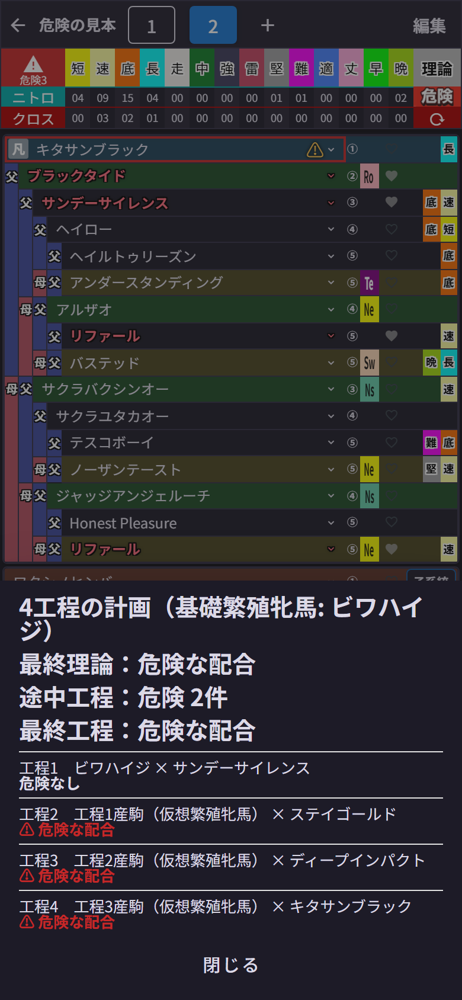
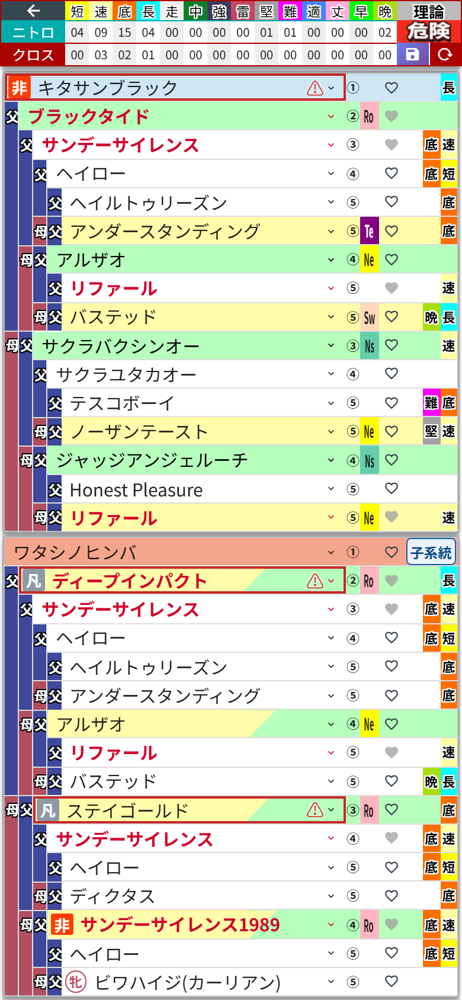

# 第6章 工程診断 ── 段階配合の落とし穴を自動で教えてくれる

ダビマス勢の腕の見せどころといえば、**段階配合**。基礎になる繁殖牝馬に何世代か種牡馬を付けて、理想の牝系を自分で作り上げていく、あの長期プロジェクトです。シーズン単位でチームを作り込む、クラブ運営そのものですね。

ただ、段階配合にはこわい落とし穴があります。最終形ばかり見ていると、**途中の世代が「危険な配合」になっている**ことに気づかないんです。ゲーム内で3世代目まで進めてから発覚したときの絶望感といったら……。

それを防いでくれるのが **工程診断** です。しかも最新版では、血統表が埋まった時点で **勝手に診断してくれます**。

## 計画の組み方

血統表の母側が、そのまま「段階配合の計画表」になります。

1. 母側のいちばん深い **「⑯種牡馬/牝馬を選択」** の枠に、基礎繁殖牝馬を選ぶ(浅い枠から始めれば工程数は少なくなります)
2. 母側の **⑭・⑩・②** の枠に、各世代で付ける種牡馬を順番に選ぶ
3. 父側の **①種牡馬** に、最終工程の種牡馬を選ぶ
4. 32マスがすべて埋まると、その場で **自動的に診断** が走ります(埋まるまでは「理論」のマスに「残り○枠」と出ています)

深い枠から先に選んでも、あとから浅い枠を選んだときに奥の馬が消えることはありません。奥から手前へ、世代の順に置いていけば大丈夫です。

## 診断してみると

最後のマスを埋めると、基礎繁殖牝馬から順に「工程1の産駒はどうなる? その仔にまた種牡馬を付けたら?」と、**仮想の繁殖牝馬を1世代ずつ作りながら全工程を判定**してくれます。危険な工程が新しく見つかったときは、結果パネルが下から自動で開きます。

この例は、ビワハイジを基礎にして、サンデーサイレンス→ステイゴールド→ディープインパクト→キタサンブラックと付けていく4工程の計画です。……なのですが、ご覧のとおり工程2以降が軒並み **危険な配合**。サンデーサイレンス系で固めすぎました。監督の私、机に突っ伏しています。

パネルの上段には、計画全体のまとめが4行で出ます。

- **N工程の計画(基礎繁殖牝馬: ○○)**
- **最終理論** …… 最後の配合で成立する理論
- **途中工程** …… 途中で危険や判定不能が何件出たか
- **最終工程** …… 最後の配合そのものが危険かどうか

その下に工程が1つずつ並び、危険な工程には **⚠ 危険な配合** と赤字が付きます。血統データが足りない馬が混ざった工程は「判定不能」と、理由まで添えて教えてくれます。

パネルを閉じても結果は残ります。

血統表では **危険な工程の種牡馬に「⚠」マーク** が付いて、そのマスが赤く囲まれます。どの種牡馬が問題だったのか、ボードの上でひと目でわかる。この安心感です。もう一度パネルを見たいときは、**「理論」のマスを押せば** 開きます。

## ①が自分で組んだ種牡馬のとき

父側のいちばん上(①)が、「★1薄め○○」のような仮の馬や、自分で保存した☆の馬のこともありますよね。その種牡馬を作るまでにも、段階配合の工程があるはずです。

そんなときは、父側の血統表も計画表として読み取って、**種牡馬側の工程** も一緒に診断してくれます。パネルは **「繁殖牝馬側の工程」** と **「種牡馬側の工程」** の2段に分かれ、種牡馬側のまとめには「種牡馬が生まれる工程」の判定が出ます。自分で組んだ種牡馬ほど途中の工程を忘れがちなので、これは本当に助かります。

## 覚えておきたい挙動

- 診断が動くのは、設定の **「工程診断を自動で行う」** がオンのとき(既定はオン)です。オフにすると診断は行われず、⚠も出ません(第13章)
- 血統表を1マスでも変えると、少し待ってから診断し直します。結果はいつでも「今の血統表」のもの
- 結果パネルが自動で開くのは、**新しく危険が見つかったときだけ**。同じ危険が残っているだけなら開かないので、直している途中に何度も邪魔されることはありません。配合を開いた直後や、保存した配合を呼び出した直後も開きません
- 全工程クリアなら、⚠はひとつも付きません。これが見たくて何度も組み直すことになります
- 血統の中で同じ馬が自分自身の先祖になってしまっている場合も、⚠ が付きます。パネルにも「血統内の自己重複：○件」として出ます

途中で危険が出たら、その工程の種牡馬を差し替えるだけ。差し替えたそばから診断し直してくれるので、何度でも試せる贅沢な機能です。
