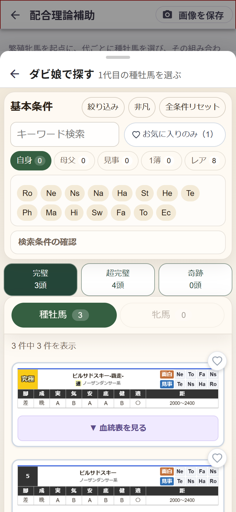
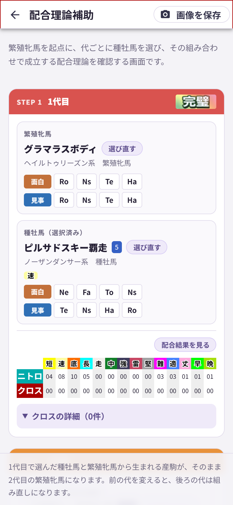
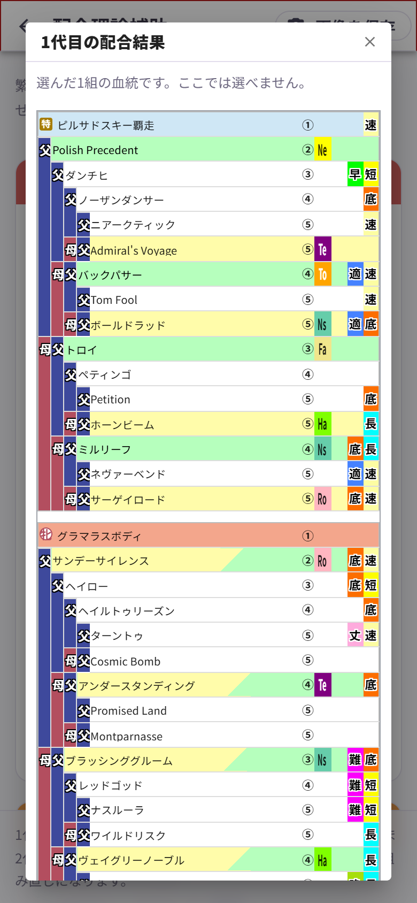

# 第7章 配合理論補助 ── 繁殖牝馬から3代先を試す

第6章の工程診断が「組み上げた計画を最後に検査する」機能だとすれば、こちらは **「1代ずつ積み上げながら、その都度どんな理論が成立するか見ていく」** 機能です。ゲーム本編の配合理論補助と同じ組み立て方ができます。

ホーム画面の **「配合理論補助」** カードから入ります。画面は **STEP 1 / STEP 2 / STEP 3** の3段。前の代を決めるまで、後ろの代は開きません。「1代目の種牡馬を選ぶと使えるようになります」と、おとなしく順番待ちをしています。

## 1代目 ── 起点の繁殖牝馬と、最初の種牡馬

**「＋ 繁殖牝馬を選ぶ」** を押すと、第4章のダビ娘が開きます。起点にしたい繁殖牝馬を選んでください。

次に **「＋ 種牡馬を選ぶ」**。ここでダビ娘がひと仕事します。

見出しが **「1代目の種牡馬を選ぶ」** に変わり、検索条件の下に見慣れないボタンが3つ並びました。

**完璧 3頭 / 超完璧 4頭 / 奇跡 0頭**

これは「いま選んでいる繁殖牝馬に対して、その理論が成立する種牡馬が何頭いるか」の実数です。押すとその候補だけに絞り込まれます。2,250頭が3頭になる。初めて押したときは、思わず声が出ました。

しかもこの件数、**危険な配合になる組み合わせは除いてあります**。数えてくれたうえに、危ない相手は最初から外してくれている。気が利きすぎです。

種牡馬を選ぶと、こうなります。

- **STEP 1 の見出しの右**に、成立した理論の絵(この例では「完璧」)
- 繁殖牝馬と種牡馬、それぞれの **面白・見事の系統コード**
- その組み合わせの **ニトロとクロスの本数**
- **クロスの詳細(N件)** …… 開くと、クロスになっている馬の名前と、何代目×何代目で重なっているかが並びます。血量が濃いものには「危険」も付きます

## 配合結果と、仮想の繁殖牝馬

**「配合結果を見る」** を押すと、選んだ1組の32マスを血統表の形で確認できます。

本体の血統表とまったく同じ見た目で、クロスの馬名もちゃんと赤字。ここでは馬は選べません。見るだけの画面です。

そして大事なのがこの一文。

> 1代目で選んだ種牡馬と繁殖牝馬から生まれる産駒が、そのまま2代目の繁殖牝馬になります。

STEP 2 の繁殖牝馬の欄には **「1代目配合の繁殖牝馬」** と **「仮想」** のラベルが付いています。**「血統表を見る」** を押せば、その仔の血統がどう組み上がったかも確認できます。あとは同じ手順で2代目・3代目の種牡馬を選んでいくだけ。下部組織から昇格させた選手を、また次のシーズンの主力に育てていく感覚です。

前の代の種牡馬を **「選び直す」** と、後ろの代はいったん白紙に戻って組み直しになります。土台を入れ替えたのだから当然なのですが、3代目まで詰めたあとにやると、ちょっとだけ切ないです(笑)。

## 画像を保存

右上の **「画像を保存」** で、3代ぶんの画面を丸ごと1枚の画像にできます。スクロールで隠れている部分まで全部入ります。

この機能、あると助かる理由がありまして。**配合理論補助の計画は、画面を出ると消えます**。血統表の配合と違って自動保存はされないので、「この組み立て、あとで見返したい」と思ったら画像を保存しておくのがいちばん確実です。ホワイトボードの前でスマホを構える監督、わりといますよね。あれです。
