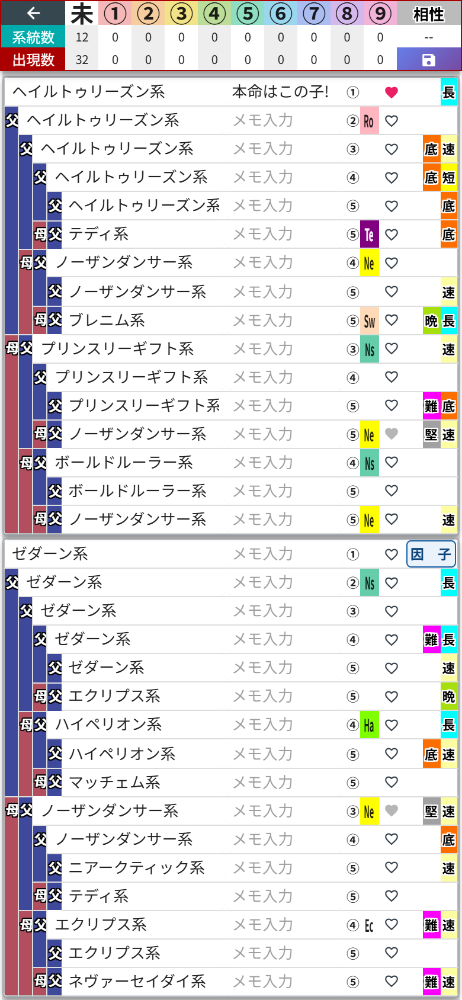

# 第8章 子系統とメモ ── ボードの裏面と、系統サマリー・相性

作戦ボードには裏面があります。
血統表の右側にある **「子系統」ボタン**(母側カードの1行目の右端。PC版は集計ヘッダーの「クロス」のマス)をタップしてみてください。

画面がガラッと変わりました。これが**子系統・メモモード**です。

## 子系統の表示

さっきまで馬名だった場所に、**その馬の子系統**(ヘイルトゥリーズン系、ノーザンダンサー系……)が表示されます。面白配合の条件を考えるとき、「父側と母側で系統がどれだけ散らばっているか」を確認する作業が欠かせないのですが、それがこの一画面で済みます。系統図を思い浮かべながらニヤニヤする時間です。

## 集計ヘッダーも「系統サマリー」に変わる

このモードでは、上の集計ヘッダーがニトロ・クロスから **系統サマリー** に切り替わります。

- **系統数** …… 血統表に何種類の子系統がいるか
- **出現数** …… その色の系統が合計何回登場するか
- **未・①〜⑨** …… 子系統に割り当てた色ごとの集計。色分けは設定画面の「子系統カラー」で決められます(第13章)。何も設定していないうちは、全部「未」の列に入ります

色分けを設定しておくと、血統表の系統名にもその色が付くので、「ノーザンダンサー系が母側に固まってるな」が一瞬で見えるようになります。

## 相性のマス

右上には **「相性」** のマスがあります(ふだんの画面の「理論」のマスと同じく、押すと工程診断、長押しで画像保存です)。32マスが埋まっていると、種牡馬と母系の系統の組み合わせから、ゲームでいう相性(ニックス)を判定して **完璧 / 優れた / 良い / 程々** の4段階で表示してくれます。該当する組み合わせがないときは「--」のまま。この画面のキタサン×エアグルーヴも「--」でした。相性まで揃えようとすると、また夜が長くなります。

## 相性の決まり方

「完璧」と「優れた」の差はどこで付くのか。ここだけ、少し算数の時間をください。

相性で見られるのは、**種牡馬の子系統**と、**繁殖牝馬側の4頭の子系統**の組み合わせです。4頭というのは、繁殖牝馬の **父・母父・母母父・母母母父**。牝系をまっすぐさかのぼったところにいる種牡馬たちですね。

組み合わせごとに決まった「相性値」があって、それに **種牡馬のレア度と枠で決まる係数** をかけて足し合わせます。係数の表はこちら。

| 種牡馬のレア度 | 父 | 母父 | 母母父 | 母母母父 |
|---|---|---|---|---|
| ★1 | 1.0 | 1.0 | 1.0 | 1.0 |
| ★2 | 1.5 | 1.5 | 1.2 | 1.0 |
| ★3 | 2.0 | 1.5 | 1.5 | 1.2 |
| ★4 | 2.5 | 2.0 | 1.5 | 1.2 |
| ★5 | 3.0 | 2.5 | 2.0 | 2.0 |

レア度を持たない馬(「★1薄め○○」や☆の馬)が種牡馬の位置にいるときは、計算できないので「--」のままです。

計算のルールは4つです。

1. **枠ごとに「相性値×係数」を出して、小数は切り上げ**。切り上げてから4枠分を足します(足してからまとめて切り上げるのではありません)
2. 相性値の決まっていない組み合わせは **0点**
3. 4頭の中に**同じ子系統が2回以上**出てきたら、2回目以降は元の相性値に関係なく **相性値1** として計算します
4. 条件を満たすと、**4×3クロスのボーナス** として合計に **3点** 上乗せされます

4つ目の条件は少し細かいです。まず、産駒から見て **繁殖牝馬側の3代前(繁殖牝馬の母父)** と **種牡馬側の4代前(種牡馬の父父父・父母父・母父父・母母父)** に同じ馬がいること。種牡馬側の4か所のうち、一致するのは **ちょうど1か所** でなければなりません。2か所以上で一致すると付かず、3と4の向きが逆(種牡馬側が3代前、繁殖牝馬側が4代前)でも付きません。さらに、「父」の枠の点が6点以上あることも必要です。配合理論の「奇跡」が成立するかどうかとは関係なく付きます。

合計点で表示が決まります。

| 合計点 | 表示 |
|---|---|
| 38点以上 | 完璧 |
| 34〜37点 | 優れた |
| 30〜33点 | 良い |
| 25〜29点 | 程々 |
| 24点以下 | -- |

レア度が高いほど係数が大きく、とくに「父」の枠が重いのがわかります。★5の種牡馬なら、繁殖牝馬の父の系統選びがそのまま勝負を分けます。

## 実例:ステイゴールド×ダダナイトはなぜ「完璧」なのか

数字だけだとピンと来ないので、実際に「完璧」になる組み合わせを分解してみます。種牡馬は **ステイゴールド**(★5、ヘイルトゥリーズン系)、繁殖牝馬は **ダダナイト** です。

ダダナイトの牝系の4頭と、ステイゴールドの系統との相性はこうなっています。

| 枠 | 馬 | 子系統 | 相性値 | 係数(★5) | 点 |
|---|---|---|---|---|---|
| 父 | メジロマックイーン | マイバブー系 | 6 | 3.0 | 18 |
| 母父 | ノーザンテースト | ノーザンダンサー系 | 6 | 2.5 | 15 |
| 母母父 | Lt.Stevens | ナスルーラ系 | 0 | 2.0 | 0 |
| 母母母父 | Bronze Babu | マイバブー系(2回目) | 1 | 2.0 | 2 |
| | | | | 小計 | **35** |

- **父と母父が、どちらも相性値6**。いちばん重い2つの枠でしっかり点を取っています。ここが土台です
- 母母父のナスルーラ系は、ヘイルトゥリーズン系との相性値が決まっていないので0点
- 母母母父のBronze Babuはマイバブー系で、父のメジロマックイーンと同じ系統。2回目なので相性値1扱いになり、係数2.0をかけて2点

ここまでで35点。表示でいうと **「優れた」** です。……あと3点。

その3点を運んでくるのが、**4×3クロスのボーナス** です。ダダナイトの母父は **ノーザンテースト**(産駒から見て3代前)。そしてステイゴールドの母母父も **ノーザンテースト**(産駒から見て4代前)。種牡馬側の4か所のうち、ここ1か所だけで一致しています。「父」の枠も18点で、6点以上の条件を満たしています。

35+3=**38点**。ちょうど「完璧」の線に届きました。

相性値の高い系統で前線を固めて、最後はノーザンテーストのクロスで押し込む。アディショナルタイムの決勝点みたいな勝ち方で、何度見ても気持ちがいいです。

## メモの入力

各マスの「メモ入力」欄には、**マスごとに自由なメモ**を書けます。私はさっそく1行目に「本命はこの子!」と書きました。字面が完全に推し活ですが、配合検討も推し活なので合っています。

- 「次はここを○○に差し替える」
- 「この枠は因子○持ちを探す」

のような検討途中の思考を置いておくのにぴったり。メモももちろん**自動保存**で、配合ごとに残ります。こちらは「この配合のこのマス」へのメモ。馬そのものに付けるメモ(第3章)とは別物です。

## 元の画面に戻る

同じ場所のボタンが **「因　子」** という表記に変わっているので、それをタップすれば元の血統表モードに戻ります。表→裏→表と、何度でも行き来してOKです。このモードでも、右下のマスは **保存ボタン(フロッピー)** のまま。保存の話は第10章で。
