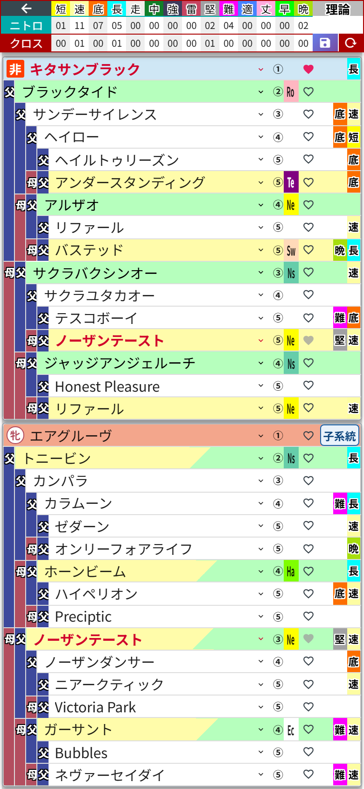

# 第9章 ハートのボタンと★の馬

## ハートのボタン ── クロスの手動指定

血統表の各行に、小さな**ハートのボタン**が付いているのに気づきましたか?

これは「この馬をクロス扱いにする」を手動で指定するボタンです。ゲーム内の特殊なルールでクロスが成立するケースなど、自動判定に乗らない組み合わせを自分で指定したいときに使います。

キタサンブラックのハートをタップしてみました。馬名が赤字になってハートがピンクに灯り、集計ヘッダーの**クロスの行にもちゃんと数字が反映**されています(「長」が01になりました)。

ハートの見た目は3種類あります。

- **白抜きのハート** …… タップで手動指定できます
- **ピンクのハート** …… 手動指定中。もう一度タップで解除
- **グレーの塗りハート** …… 押せない状態。自動判定ですでにクロスしている馬のときか、32マスがまだ埋まっていないときです

そう、**手動指定ができるのは血統表が全部埋まってから**。途中の段階では全部グレーで並んでいますが、故障ではありません。メンバー表が揃うまでは交代カードも切れない、ということですね。

## ★の馬 ── 自動で生まれる「薄め」の馬

血統表をいじっていると、名前が **「★」から始まる馬** が現れることがあります。たとえば深いマスに種牡馬を置いたとき、その手前の枠が「★1薄めブラックタイド」のような馬で埋まる、あの現象です。

これはダビふぁくが自動で作る**仮の馬**で、「この配合を成立させるには、間にこういう馬を挟む必要がありますよ」という印。ゲームでいう薄め配合のつなぎ役です。母側の先頭に現れる「ワタシノヒンバ」も同じ仲間で、まだ名前のない自分の繁殖牝馬を表しています。

★の馬は因子のデータを持っていないので、マスを選ぶと、その行の因子の欄に **「因子」ボタン** が出ます(第8章の表裏を切り替える「因子」とは別物です)。タップすると因子選択ダイアログが開いて、その馬に持たせたい因子を **短・速・底・長・堅・難から1〜2個** 選べます。設定した因子は、もちろんニトロ集計にも反映されます。ゲームで生産した馬の因子をそのまま入れておけば、集計もずれません。

なお、★の馬はクロス判定の対象外です。仮の馬どうしで赤字が出てしまわないようになっています。

ちなみに、似た記号で **「☆」から始まる馬**(検索では「自」バッジ)もいますが、こちらは自分で保存した配合から生まれた馬。次の章の主役です。自前で育てた選手、と言えばもう伝わりますね。
