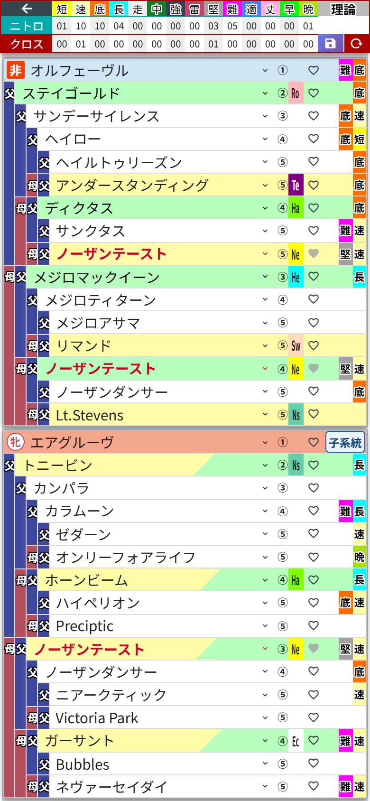

# 第11章 配合の複製 ── プランA・B・Cを並べて悩む幸せ

ここが統合版のいちばんの推しポイントです。

「今の配合、父だけ別の馬にしたらどうなる?」……試したいけれど、今の血統表は崩したくない。そんなときは、配合を **まるごと複製** してしまいましょう。

1. 左上の **「←」** でホームに戻る(今の配合は自動保存されています)
2. 右上の **「編集」** を押す
3. 複製したい配合のカードの **「複製」** を押す

すぐ隣に **「王座予選のコピー」** のような配合が生まれました。中身は元の配合とそっくり同じ。血統表も、メモも、手動のクロス指定も、ぜんぶ一緒にコピーされています。名前は12文字までなので、長い名前のときは元の名前の後ろが少し縮みます。

「完了」で編集モードを終えて、コピーのほうを開けば、あとは自由に選手交代です。

コピーのほうで、父をキタサンブラックからオルフェーヴルに替えてみました。底のニトロが07から10に伸びています。元の配合はそのまま残っているので、ホームに戻って開き直せば、いつでも見比べられます。「プラン1とプラン2、ニトロの伸びはどっちが上だろう?」が、カードのタップだけで確かめられる。4-3-3と4-4-2を並べて悩む監督の気持ち、味わえます。

名前を「王座予選B」のように付け直したいときは、編集モードでカードをタップすれば変えられます(第12章)。

## 切り替えのしくみ(ざっくり)

ホームに戻る瞬間に今の配合を保存して、カードをタップした瞬間にその配合を復元しています。だから **保存ボタンを押す必要は一切ありません**。第10章の「配合の保存」は、完成した配合を☆の馬として残すための別の機能です。
