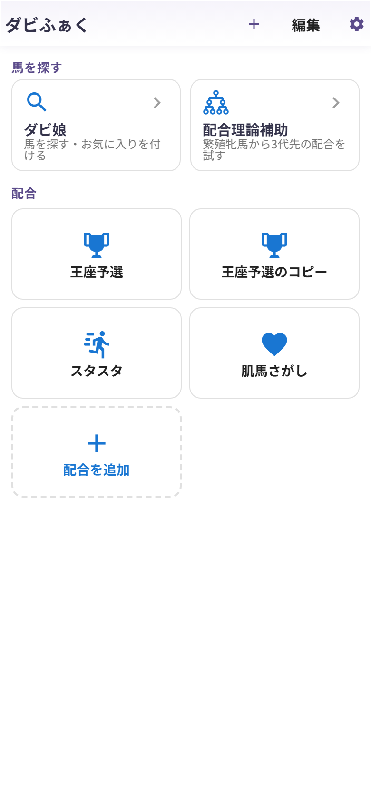
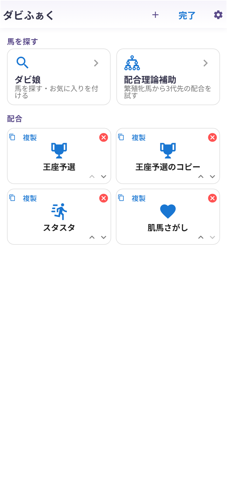

# 第12章 ホーム画面を育てよう

血統表の左上の **「←」** でホームに戻れます(このときも今の配合は自動保存されます)。
配合をいくつか作ると、ホームはこんな感じになっていきます。

スマホは2列、タブレットは3列、PCは4列で並びます。並びの最後にある点線の **「配合を追加」** カードから、いつでも新しい配合を足せます。

## 編集モード

右上の **「編集」** を押すと、編集モードに切り替わります。

- **カードをタップ** …… 名前とアイコンの変更
- **「複製」** …… その配合をまるごとコピーして、すぐ隣に置きます(第11章)
- **赤い「×」** …… 配合の削除
- **「∧」「∨」** …… 表示順の並び替え

終わったら「完了」で通常モードへ。

## 削除だけは、レッドカード級の慎重さで

ひとつだけ、監督としての注意事項です。
**配合を削除すると、その血統表・メモ・クロス指定もまとめて消えます**。確認ダイアログは出ますが、**取り消しはできません**。

一方で、「配合の保存」で保存した配合と☆の馬、馬のメモ、そしてダビ娘で付けた❤のお気に入りは共有の財産なので、ホームの配合を消しても残ります。「消す前に、残したいプランは配合保存へ」──これを合言葉にしてください。
