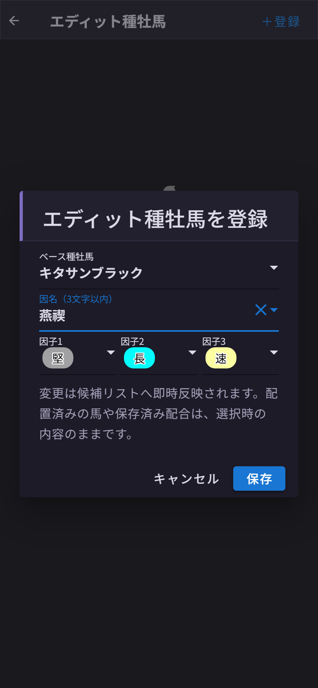
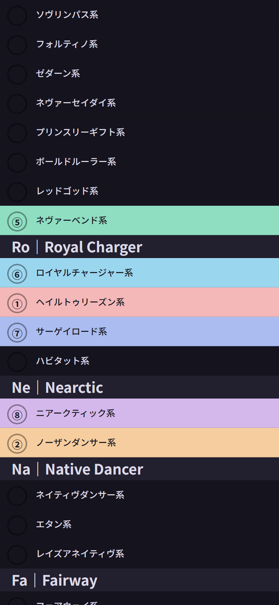

# 第13章 設定画面 ── エディット種牡馬・ダビ娘の血統表・工程診断・表示テーマ・文字の大きさ・子系統カラー

ホーム画面の右上、**歯車のマーク**から設定画面に入れます。メニューは6つ。どれも、自分の使い方に合わせてボードを整えるための機能です。

## エディット種牡馬

ダビマスにはエディット種牡馬(自分のゲームで作った、因子付きの種牡馬)がいますよね。あの子たちをダビふぁくにも登録して、検索候補に並べられます。

**「＋登録」** を押すと、登録ダイアログが開きます。

- **ベース種牡馬** …… 元になる馬を検索して選びます
- **因名(3文字以内)** …… ゲーム内の因名をそのまま入力。既存の因名を候補から選ぶと、**対応する因子が自動でセットされる**気配りつき(この画面では「燕禊」を選んで、堅・長・速が勝手に入りました)
- **因子1〜3** …… その馬が持つ因子を設定

保存すると「キタサンブラック燕禊」のような名前で、**「E」バッジ**付きで検索候補に加わります。登録できるのは**100件まで**。一覧からいつでも編集・削除できます(変更はすぐ候補に反映されます。すでに血統表に置いた馬や保存した配合は、選んだときの内容のまま残ります)。

自軍のエディット種牡馬が普通に検索で出てくる。地味なようで、使い始めると戻れない機能です。

## ダビ娘の血統表

第4章のダビ娘で、馬のカードの血統表を **「最初から開く」** かどうかのスイッチです。

既定はオフ(畳んだ状態)。カード1枚に15行ぶんの血統表が付くので、常に開いておくと一覧のスクロールがかなり重くなります。「血統を見ながら流し読みしたい」という日はオン、「とにかく速く一覧をめくりたい」日はオフ。

## 工程診断を自動で行う

第6章の工程診断を、血統表が埋まったときに自動で行うかどうかのスイッチです。既定は **オン**。

オンなら、危険な工程の種牡馬に⚠が付いて赤枠で囲まれ、新しい危険が見つかったときは結果パネルが開きます。オフにすると診断そのものを行わないので、⚠も出ず、「理論」のマスを押してもパネルは開きません。段階配合をしない日は、オフで静かに組むのもありです。

## 表示テーマ

**ダーク / ライト / 端末に合わせる** の3択です。既定は **ライト**。この記事の画面もライトで撮っています。

夜に布団の中で配合を考える派の方は、ダークがおすすめです。画面の地が黒くなって、目にやさしくなります。血統表の色分け(緑=面白枠、黄=見事枠、紺=父、臙脂=母)も、色合いはそのままで、明るさだけ落としてあります。読み方は変わりません。

「端末に合わせる」を選ぶと、スマホやPCの設定に追従します。夜だけ暗くなってほしい派の方は、これが正解。選んだ瞬間に切り替わって、次に開いたときも覚えています。

## 馬名の文字の大きさ

スマホの血統表に出る馬名の大きさを、**大 / 小** から選べます。既定は **小**。

大にすると馬名が読みやすくなるかわりに、長い名前は後ろが切れやすくなります。「★1薄めシンボリルドルフ巌瓏」のような長い名前をよく使う方は小、見やすさ優先なら大。ここはもう好みなので、両方試してみてください。

## 子系統カラー

最後のメニューが **子系統カラー**。58ある子系統に、**9つの色**を自由に割り当てられます。

子系統は親系統(Ec｜Eclipse、Ph｜Phalaris、Ns｜Nasrullah……)ごとにグループ分けされていて、行をタップすると色を選べます。画面上部には **「設定済み ○ / 58」** のカウンター。**「色ラベル」** から各色に名前(10文字まで)を付けられるので、「①=スピード系」「②=スタミナ系」のような自分ルールも作れます。**「すべて解除」** でいつでもまっさらに戻せます。

ここで割り当てた色は、第8章の**子系統・メモモードの色分け**と**系統サマリーの集計**にそのまま反映されます。ユニフォームの色分けを決めるのは監督の仕事。自分の目が追いやすい配色を、ぜひ探してみてください。
